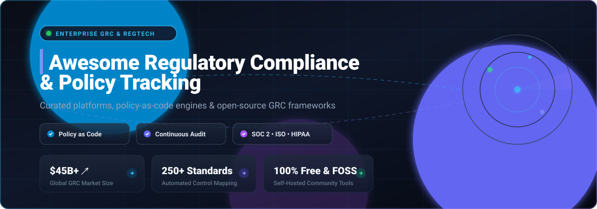

  

# 🛡️ Awesome Regulatory Compliance & Policy Tracking 📜

> 🌟 **A curated list of top Regulatory Compliance and Policy Tracking platforms** — encompassing enterprise SaaS/commercial Governance, Risk, and Compliance (GRC) suites, policy-as-code engines, and self-hosted open-source software for monitoring legal regulations, governing corporate policies, and automating audit-ready compliance evidence. 
> 
> ⭐ **Star this repository if you find it helpful!** ⭐

---

## 📑 Table of Contents

- [🌐 Sector Overview & Market Dynamics](#-sector-overview--market-dynamics)
- [🏢 SaaS & Hosted Commercial Platforms](#-saas--hosted-commercial-platforms)
  - [Feature Deep-Dive](#-commercial-grc-deep-dive)
- [💻 Open-Source Software & Policy Engines](#-open-source-software--policy-engines)
  - [Open-Source Solutions Deep-Dive](#-open-source-solutions-deep-dive)
- [📊 Comparison at a Glance](#-comparison-at-a-glance)
- [📈 Star History](#-star-history)
- [💖 Support & Sponsorship](#-support--sponsorship)
- [🤝 Contributing](#-contributing)
- [📄 License](#-license)

---

## 🌐 Sector Overview & Market Dynamics

The global Governance, Risk, and Compliance (GRC) software market was valued at approximately **$45.3 billion to $52.0 billion** and is projected to expand beyond **$105.0 billion by 2030**, advancing at a robust compound annual growth rate (**CAGR of ~11.8% to 13.2%**). 

From a market structure standpoint, the sector is **moderately to highly fragmented** rather than a winner-take-all monopoly: while legacy mega-cap titans (such as ServiceNow, IBM, and SAP) dominate core enterprise IT workflows, hundreds of specialized point solutions thrive across compliance automation (e.g., SOC 2 / ISO 27001 continuous auditing), data privacy governance, third-party vendor risk management (TPRM), and policy-as-code engines—spurring aggressive private-equity rollups and consolidation across the industry.

---

## 🏢 SaaS & Hosted Commercial Platforms

Below is an overview of commercial, cloud-hosted Regulatory Compliance and Policy Tracking solutions, sorted in descending order by **company scale (valuation / market capitalization / revenue)**.

| Platform 🚀 | Company Scale & Valuation 📈 | Primary Focus & Target Audience 🎯 | Starting Price (Specific Tier) 💵 | Free Tier Limits / Trial Terms ⏳ |
|---|---|---|---|---|
| **[ServiceNow GRC](https://www.servicenow.com/products/governance-risk-and-compliance.html)** | **~$160B - $218B Market Cap** (~$13.2B Annual Revenue) | Enterprise Integrated Risk Management (IRM) built into ServiceNow ITSM ecosystem | **$125 / user / month** ($1,500/year list price for IRM Standard Operator; enterprise deployments start at ~$60,000/yr) | **No public free tier**; 30-day developer/trial instances available via partner channels and Now Learning training simulators |
| **[OneTrust](https://www.onetrust.com/)** | **~$4.5B - $5.0B Valuation** (~$500M+ ARR) | Privacy management, consent tracking, AI governance & compliance | **$800 / month** ($9,600/year for Consent & Preferences module; minimum annual contracts start at $10,000/yr) | **0 days free trial**; no free-forever tier, evaluation is restricted to guided custom live demos |
| **[Diligent HighBond](https://www.diligent.com/)** | **~$4.0B Valuation** (~$550M+ Annual Revenue) | Connected GRC, board governance, internal audit analytics & ESG | **$416 / month** ($5,000/year baseline starting license for entry audit/point solutions) | **No standard free tier**; 14-day evaluation trial limited to selected modular add-ons (GovernAI / Board portals) |
| **[AuditBoard](https://www.auditboard.com/)** | **~$3.0B+ Valuation** (~$300M+ ARR; acquired by Hg) | Connected risk, SOX compliance, ESG & internal audit automation | **$2,083 / month** ($25,000/year entry point for single-module mid-market teams; typical suites start at $45,000/yr) | **0 days free trial**; no public self-service sandbox, proof-of-concept provided exclusively via sales demos |
| **[Archer](https://www.archerirm.com/)** | **~$2.0B+ Enterprise Value** (~$230M - $255M Revenue) | Multi-domain enterprise Integrated Risk Management (IRM) | **$4,583 / month** ($55,000/year entry-level annual subscription contract for targeted use-case modules) | **0 days free trial**; no self-serve free sandbox, evaluation governed through structured sales PoC programs |
| **[MetricStream](https://www.metricstream.com/)** | **~$478M+ Valuation** (~$180M - $240M Revenue) | Enterprise risk, policy management, IT cyber GRC & regulatory reporting | **$6,250 / month** ($75,000/year baseline starting annual contract for entry enterprise instances) | **0 days free tier**; interactive self-guided video walkthroughs provided, live testing restricted to sales PoC sandbox |
| **[LogicGate](https://www.logicgate.com/)** | **~$160M+ Raised / ~$50M Valuation** (~$49M ARR) | No-code Risk Cloud workflow automation & dynamic regulatory mapping | **$1,083 / month** ($13,000/year entry contract tier for restricted application suites; mid-market bundles start at ~$25,000/yr) | **0 days free trial**; no free self-serve plan, customized sandbox environments provisioned following discovery calls |
| **[Resolver](https://www.resolver.com/)** | **~$15M - $50M Est. Revenue** (Division of Kroll) | Corporate security, compliance tracking, risk management & incident triage | **$833 / month** ($10,000/year entry starting contract for single business-unit risk modules) | **0 days free tier**; custom sandbox proof-of-concept delivered upon scoping with solution architects |

### 🔍 Commercial GRC Deep-Dive

* **ServiceNow GRC**: Integrates risk, compliance, policy lifecycles, and audit management directly into corporate ServiceNow instances. Ideal for organizations that have already standardized on ServiceNow for IT Service Management (ITSM) and asset tracking.
* **OneTrust**: The market leader in privacy and trust intelligence. Encompasses automated consent management, sensitive data mapping, Privacy Impact Assessments (PIAs), vendor risk ratings, and global policy compliance.
* **Diligent HighBond**: Unifies GRC controls with deep forensic data analytics. Gives internal audit and risk leaders real-time visibility into control failures, compliance anomalies, and executive board reporting.
* **AuditBoard**: A modern, collaborative risk and compliance platform centered on SOXHUB, OpsAudit, and CrossComply. Frequently chosen by internal audit teams seeking an agile, intuitive alternative to legacy suites.
* **Archer**: A venerable enterprise standard in Integrated Risk Management (IRM). Provides granular governance modeling, risk scoring algorithms, and regulatory requirement mapping for heavily regulated enterprises.
* **MetricStream**: Designed for global multinational corporations and federal bodies requiring comprehensive governance across enterprise risk, quality controls, operational resiliency, and cyber compliance.
* **LogicGate Risk Cloud**: Features a drag-and-drop visual process workflow builder and application marketplace for policy lifecycles, third-party assessments, and controls testing without developer intervention.
* **Resolver**: Combines corporate risk management, regulatory compliance monitoring, and incident investigations into unified actionable intelligence feeds.

---

## 💻 Open-Source Software & Policy Engines

The following community-driven, open-source GRC solutions and policy-as-code engines are sorted in descending order by **GitHub Stars_Count**. Every badge links directly to the project's real-time GitHub stargazers.

| Project & Repository 📦 | GitHub_Stars 🌟 | Tech Stack 🛠️ | License 📜 | Best For & Core Value Proposition 🎯 |
|---|---|---|---|---|
| **[Open Policy Agent (OPA)](https://github.com/open-policy-agent/opa)** |  | Go / Rego | Apache-2.0 | General-purpose policy engine across microservices, Kubernetes, CI/CD pipelines & cloud APIs |
| **[Kyverno](https://github.com/kyverno/kyverno)** |  | Go / Kubernetes CRD | Apache-2.0 | Kubernetes-native policy-as-code management, validation, mutation & container image verification |
| **[CISO Assistant](https://github.com/intuitem/ciso-assistant-community)** |  | Python / Django / React | Open Source | Full-spectrum GRC platform supporting 150+ frameworks (ISO 27001, NIST, SOC 2, DORA, NIS2) with auto-mapping |
| **[Gatekeeper](https://github.com/open-policy-agent/gatekeeper)** |  | Go / Rego / K8s | Apache-2.0 | Validating and mutating webhook admission controller enforcing OPA policies for cluster compliance |
| **[ComplianceAsCode](https://github.com/ComplianceAsCode/content)** |  | Python / SCAP / Ansible | ComplianceAsCode | Automated security baseline policies, compliance checks & SCAP/Ansible remediation content for CIS/NIST |
| **[OSS Review Toolkit (ORT)](https://github.com/oss-review-toolkit/ort)** |  | Kotlin / Java / Docker | Apache-2.0 | Automated open-source license compliance pipelines, dependency scanning, SBOM generation & curation rules |
| **[Comp AI](https://github.com/trycompai/comp)** |  | TypeScript / Node / Postgres | AGPL-3.0 | AI-native compliance platform with natural language policy editing & automated continuous evidence extraction |
| **[Probo](https://github.com/getprobo/probo)** |  | Go / Postgres / GraphQL | ISC | Modern engineering-first GRC with versioned policy approvals, public trust portals & 270+ MCP AI tools |
| **[Allstar](https://github.com/ossf/allstar)** |  | Go / GitHub App | Apache-2.0 | OpenSSF continuous security policy enforcement bot checking organization repos for compliance drift |
| **[PacBot](https://github.com/tmobile/pacbot)** |  | Java / Angular / AWS | Apache-2.0 | Enterprise-scale policy evaluation, continuous cloud compliance monitoring & automated remediation |
| **[FOSSology](https://github.com/fossology/fossology)** |  | C / PHP / C++ | GPL-2.0-only | Linux Foundation open-source license compliance suite, copyright detection & SPDX document generation |
| **[OpenGRC](https://github.com/LeeMangold/OpenGRC)** |  | Python / Flask / Web | MIT | Lightweight, zero-fuss GRC web app designed for SMB security controls, framework imports & audits |
| **[SimpleRisk](https://github.com/simplerisk/code)** |  | PHP / MySQL | Community | Rapid-deployment GRC platform mapping 250+ regulatory frameworks directly to 1,250+ security controls |
| **[Eramba](https://github.com/eramba/docker)** |  | PHP / Docker / MySQL | Community | Comprehensive multi-framework GRC tool managing enterprise risk registers, internal controls & policy audits |
| **[OSPAC](https://github.com/SemClone/ospac)** |  | Python / YAML / JSON | PyPI FOSS | Open Source Policy as Code engine for automated license compatibility & obligation tracking across 712+ SPDX tags |
| **[federal-register-mcp](https://github.com/VeronaStrategic/federal-register-mcp)** |  | Python / MCP Server | Open Source | Read-only Model Context Protocol (MCP) server delivering live US Federal Register regulatory tracking to AI agents |

### 🛠️ Open-Source Solutions Deep-Dive

* **[Open Policy Agent (OPA)](https://github.com/open-policy-agent/opa)**: General-purpose policy engine that unifies policy enforcement across cloud-native stacks using the declarative query language **Rego**. Decouples compliance rules from runtime application services.
* **[Kyverno](https://github.com/kyverno/kyverno)**: Kubernetes-native policy management tool designed specifically for cluster administrators. Validates, mutates, and generates Kubernetes resources using familiar YAML declarative patterns.
* **[CISO Assistant](https://github.com/intuitem/ciso-assistant-community)**: Comprehensive community GRC tool covering risk registers, vendor assessments, and audit workflows across 150+ international compliance frameworks (ISO 27001, SOC 2, HIPAA, NIST CSF).
* **[Gatekeeper](https://github.com/open-policy-agent/gatekeeper)**: Integrates OPA directly into Kubernetes admission pipelines, blocking non-compliant cluster manifests before deployment.
* **[ComplianceAsCode](https://github.com/ComplianceAsCode/content)**: High-security compliance content project providing machine-readable configuration baselines and automated remediation scripts for Red Hat, Debian, Ubuntu, and container hosts.
* **[OSS Review Toolkit (ORT)](https://github.com/oss-review-toolkit/ort)**: Industry-grade open-source license governance toolsuite that parses build dependencies, creates Software Bills of Materials (SBOMs), and flags licensing policy violations.
* **[Comp AI](https://github.com/trycompai/comp)**: Built as a transparent open-source alternative to proprietary compliance automation systems (like Vanta and Drata). Features an AI policy editor with side-by-side diffing and endpoint compliance checking.
* **[Probo](https://github.com/getprobo/probo)**: Developer-centric GRC platform with document version control, quorum signature workflows, public trust center hosting, and 270+ native Model Context Protocol (MCP) tools for LLM agent integration.
* **[Allstar](https://github.com/ossf/allstar)**: OpenSSF automated security bot that monitors GitHub repositories against organizational policies (branch protection, outside collaborators, security advisories).
* **[PacBot](https://github.com/tmobile/pacbot)**: T-Mobile's continuous cloud compliance platform. Evaluates resources against defined policies, generates compliance metrics, and automatically fixes policy violations in AWS and multi-cloud accounts.
* **[FOSSology](https://github.com/fossology/fossology)**: Linux Foundation-backed compliance toolkit capable of scanning deep code repositories to identify licenses, copyrights, and export restrictions.
* **[OpenGRC](https://github.com/LeeMangold/OpenGRC)**: Simple, MIT-licensed cyber GRC tool for small teams seeking an uncluttered compliance management dashboard without enterprise overhead.
* **[SimpleRisk](https://github.com/simplerisk/code)**: Intuitive GRC suite that enables organizations to go from zero to fully configured risk management in minutes, complete with 250+ pre-mapped control catalogs.
* **[Eramba](https://github.com/eramba/docker)**: Mature open-source GRC solution for organizations managing multiple concurrent frameworks, internal control audits, and risk assessment workflows.
* **[OSPAC](https://github.com/SemClone/ospac)**: Policy-as-code CLI and Python library that models license compatibility matrices, obligation tracking, and distribution constraints in versioned Git files.
* **[federal-register-mcp](https://github.com/VeronaStrategic/federal-register-mcp)**: AI-first Model Context Protocol (MCP) server enabling LLMs (such as Claude, ChatGPT, and Gemini) to monitor US Federal Register rulemaking, final rules, and executive orders.

---

## 📊 Comparison at a Glance

| Solution 🔍 | Category 🏷️ | Deployment Model 🚀 | Policy Management 📑 | Regulatory Frameworks 📋 | Automated Evidence 🤖 | Open Source 💻 |
|---|---|---|---|---|---|---|
| **ServiceNow GRC** | Enterprise IRM | Cloud SaaS | ✅ Advanced | ✅ Global Multi-Framework | ✅ Native ITSM | ❌ Proprietary |
| **OneTrust** | Trust & Privacy | Cloud SaaS | ✅ Privacy & Consent | ✅ Global Privacy & AI | ✅ Workflow Integrations | ❌ Proprietary |
| **Diligent HighBond** | GRC & Analytics | Cloud SaaS | ✅ Built-in | ✅ Pre-built Catalogs | ✅ Forensic Data Connectors | ❌ Proprietary |
| **AuditBoard** | Connected Risk | Cloud SaaS | ✅ Standard | ✅ SOX / ISO / SOC 2 | ✅ Workflow Automation | ❌ Proprietary |
| **Archer** | Enterprise IRM | Cloud / On-Prem | ✅ Mature | ✅ Comprehensive IRM | ✅ API & Integrations | ❌ Proprietary |
| **MetricStream** | Enterprise GRC | Cloud SaaS | ✅ Advanced | ✅ Enterprise Global | ✅ AI Compliance Feeds | ❌ Proprietary |
| **LogicGate** | Agile GRC | Cloud SaaS | ✅ Visual Builder | ✅ Pre-configured Apps | ✅ No-Code Integrations | ❌ Proprietary |
| **Resolver** | Risk & Security | Cloud SaaS | ✅ Centralized | ✅ Security & Regulatory | ✅ Incident Feeds | ❌ Proprietary |
| **Open Policy Agent (OPA)** | Policy-as-Code | Self-Hosted / Binary | ✅ Declarative Rego | Custom Rulesets | ✅ Real-time Policy Engine | ✅ Apache-2.0 |
| **Kyverno** | Policy-as-Code | Kubernetes Native | ✅ Kubernetes CRD | Kubernetes Standards | ✅ Admission & Audit Logs | ✅ Apache-2.0 |
| **CISO Assistant** | Open-Source GRC | Self-Hosted / Docker | ✅ Integrated | ✅ 150+ Frameworks | ✅ API Integrations | ✅ Open Source |
| **Gatekeeper** | Policy-as-Code | Kubernetes Native | ✅ OPA Constraints | Cluster Governance | ✅ Audit Controller | ✅ Apache-2.0 |
| **ComplianceAsCode** | Security Baselines | Self-Hosted / Scriped | ✅ Baselines / SCAP | ✅ CIS / NIST Baselines | ✅ Automated Remediation | ✅ Open Source |
| **OSS Review Toolkit (ORT)**| License & SBOM | CI/CD / Docker | ✅ License Rules | SPDX / OSS Licenses | ✅ Automated Scanners | ✅ Apache-2.0 |
| **Comp AI** | Compliance Automation| Self-Hosted / Cloud | ✅ AI-Powered | ✅ SOC 2 / ISO / HIPAA | ✅ Continuous Endpoint Agent| ✅ AGPL-3.0 |
| **Probo** | Open-Source GRC | Self-Hosted / Docker | ✅ Versioned Approvals | ✅ Custom & Standard | ✅ 270+ MCP AI Tools | ✅ ISC |
| **Allstar** | Security Policy Bot | GitHub App | ✅ GitHub Policies | OpenSSF Guidelines | ✅ Continuous Drift Checks | ✅ Apache-2.0 |
| **PacBot** | Cloud Compliance | Multi-Cloud / Docker | ✅ Policy-as-Code | CIS / Cloud Benchmarks | ✅ Automated Fixers | ✅ Apache-2.0 |
| **FOSSology** | License Governance | Self-Hosted / Docker | ✅ License Auditing | SPDX / Copyrights | ✅ Deep Code Scanning | ✅ GPL-2.0-only |
| **OpenGRC** | Lightweight GRC | Self-Hosted / Web | ✅ Light | ✅ Importable Catalogs | ✅ Audit Reporting | ✅ MIT |
| **SimpleRisk** | Rapid GRC | Self-Hosted / Docker | ✅ Native Catalog | ✅ 250+ Mapped Frameworks | ✅ Control Testing Logs | ✅ Community |
| **Eramba** | Multi-Framework GRC| Self-Hosted / Docker | ✅ Mature | ✅ Multiple Standards | ✅ Evidence Repository | ✅ Community |
| **OSPAC** | License Policy Engine| CLI / Python Library | ✅ YAML / JSON | 712+ SPDX Licenses | ✅ Checklist Generation | ✅ PyPI FOSS |
| **federal-register-mcp** | Regulatory AI Agent | MCP Server / Docker | ❌ Read-Only Feeds | US Federal Register | ✅ LLM Context Injection | ✅ Open Source |

---

## 📈 Star History

---

## 💖 Support & Sponsorship

Thank you so much for exploring this curated guide to Regulatory Compliance & Policy Tracking! If you found this repository helpful, please consider supporting the project:

- ⭐ **Star this repository** to help others discover it on GitHub.
- 🍴 **Fork and contribute** by submitting new tools or updates via Pull Requests.
- 📢 **Share** with your network, engineering teammates, or GRC professionals.
- ☕ **Buy me a coffee**: If this project saved you time or added value to your compliance stack evaluation, you can sponsor further development and maintenance on the [GitHub Sponsors Dashboard](https://github.com/sponsors/ishandutta2007).

---

## 🤝 Contributing

Contributions from the compliance, legal, security, and developer communities are welcome! If you know of an outstanding open-source tool, policy engine, or platform that should be included:

1. 🍴 **Fork** this repository.
2. 🌿 **Create a branch** for your addition (`git checkout -b feature/add-new-tool`).
3. 📝 **Add the project** under the relevant section with:
   - Official project repository or website URL
   - Stargazer social badge (for open-source tools)
   - Tech stack and license
   - Concise summary of value proposition
4. 🚀 **Submit a Pull Request** explaining why the tool stands out.

Please ensure that submitted open-source projects are actively maintained (updated within the last 12 months) and adhere to transparent open-source licensing.

---

## 📄 License

This repository and curated list are published under the [CC0 1.0 Universal (Public Domain Dedication)](https://creativecommons.org/publicdomain/zero/1.0/). All listed third-party trademarks, logos, and project names are the property of their respective owners.

---

  ⭐ <b>If you found this list valuable for your GRC or compliance initiatives, please give it a star!</b> ⭐

